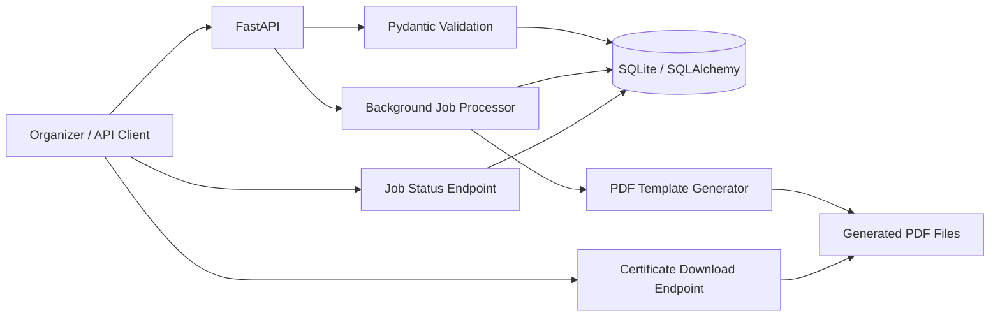

# Bulk Certificate Generator

> Turn a participant list into downloadable certificates with one request.

This project is a small, production-minded FastAPI application for organizations that need to issue certificates after an event, course, or training program. A client submits a cohort once, the service generates one PDF per recipient, and the interface shows which certificates are ready, still processing, or need attention.

The implementation is intentionally easy to run and easy to discuss in an interview: a clean REST API, a relational data model, isolated background work, a predefined PDF template, and a focused test suite.

## Product Walkthrough

1. An organizer enters the event details and adds one or more recipients in the web UI.
2. The API validates every field and creates a generation job with one certificate record per recipient.
3. The request returns immediately with a job ID while background processing begins.
4. The organizer can watch the counters move from `pending` to `processing` and finally to `completed`, `partial`, or `failed`.
5. Each successful recipient gets an individual PDF download link. A failed recipient shows its error without blocking everyone else.

## UI Preview

The interface is designed for a practical operations workflow rather than a marketing page:

- A warm, editorial visual style makes the certificate workflow feel human and celebratory.
- The left panel handles job creation and recipient entry.
- The right panel provides a dark, high-contrast status board for quick scanning.
- Clear counters show `Total`, `Ready`, and `Failed` certificates at a glance.
- Each recipient row ends with an obvious `Download` action or a readable failure message.
- The layout is responsive and works on smaller screens without hiding the core workflow.

The browser client is a lightweight HTML and JavaScript frontend styled with Tailwind CSS. The API is independent of the UI and can also be used from another client.

## Architecture



### Main components

| Area | Implementation | Responsibility |
| --- | --- | --- |
| HTTP API | FastAPI | Job creation, status, and downloads |
| Validation | Pydantic | Names, emails, dates, and batch limits |
| Persistence | SQLAlchemy + SQLite | Jobs, recipients, statuses, and errors |
| Processing | FastAPI `BackgroundTasks` | Non-blocking bulk generation |
| Certificates | Standard-library PDF writer | Single predefined landscape A4 template |
| Frontend | HTML, JavaScript, Tailwind CDN | Submit jobs and monitor results |
| Testing | Pytest + FastAPI `TestClient` | API behavior and failure scenarios |

## Project Structure

```text
app/
├── main.py                    # FastAPI routes and application lifecycle
├── config.py                  # Environment-backed settings
├── database.py                # SQLAlchemy engine and sessions
├── models.py                  # Job and certificate persistence models
├── schemas.py                 # Request and response contracts
├── services/
│   ├── certificate.py         # Predefined PDF certificate template
│   └── jobs.py                # Per-recipient background processing
└── static/
    ├── index.html             # Tailwind user interface
    └── app.js                 # Submission, polling, and rendering
tests/
└── test_api.py                # End-to-end API tests
```

## Quick Start

Requires Python 3.11+.

```bash
python -m venv .venv
source .venv/bin/activate
pip install -e '.[dev]'
uvicorn app.main:app --reload
```

Then open:

- Web UI: `http://127.0.0.1:8000`
- Interactive API docs: `http://127.0.0.1:8000/docs`

The default SQLite database is stored in `data/certificates.db`. Generated PDFs are stored under `data/generated/`. To use another SQLAlchemy-supported relational database, set `DATABASE_URL` in `.env`.

## API

### Create a generation job

```bash
curl -X POST http://127.0.0.1:8000/api/jobs \
  -H 'Content-Type: application/json' \
  -d '{
    "title": "Python Foundations",
    "issuer": "Northstar Academy",
    "issue_date": "2026-10-10",
    "recipients": [
      {
        "name": "Ada Lovelace",
        "email": "ada@example.com",
        "course": "Python",
        "completion_date": "2026-10-09"
      }
    ]
  }'
```

The endpoint responds with `202 Accepted` and a job ID. The initial status may be `pending` because generation happens in the background.

### Check job progress

```bash
curl http://127.0.0.1:8000/api/jobs/{job_id}
```

The response includes:

- Overall status: `pending`, `processing`, `completed`, `partial`, or `failed`
- Total recipient count
- Successful and failed counts
- Per-recipient status and error details
- Download URLs for completed certificates

### Download a certificate

```bash
curl -L http://127.0.0.1:8000/api/certificates/{certificate_id} \
  --output certificate.pdf
```

## Validation and Failure Handling

The API rejects malformed requests before creating a job. It validates:

- Required event and issuer information
- Valid email addresses
- Non-empty recipient names and courses
- Valid dates
- At least one and no more than 1,000 recipients per request

Each recipient is stored as an independent certificate record before processing. If one PDF fails to generate, that record becomes `failed` with an error message while the remaining recipients continue. A job with both successes and failures is reported as `partial`, making the outcome clear without requiring the client to inspect logs.

## Tests

```bash
pytest
```

The test suite covers:

- Creating a bulk generation job
- Request validation and invalid email handling
- Certificate generation and PDF content type
- Job progress and success counters
- One recipient failing while another succeeds
- Retrieving a generated certificate file

## Design Decisions

### Why background processing?

The API should not hold an HTTP request open while generating a large batch. FastAPI `BackgroundTasks` keeps this submission responsive and avoids requiring Redis or another service for a focused assessment project.

For a production deployment with multiple application workers, retries, or very large batches, the processing function can move behind Celery, RQ, or a managed queue. The database-backed job model already provides the status contract that a queue worker would update.

### Why SQLite?

SQLite keeps the project immediately runnable while still demonstrating a relational design. The application uses SQLAlchemy, so moving to PostgreSQL mainly requires changing `DATABASE_URL` and deploying shared file storage for generated PDFs.

### Why one template?

The requirement calls for a single predefined certificate design. The template includes the recipient name, course, issuer, completion date, issue date, and a unique certificate ID without introducing the complexity of a template editor.

## Assessment Notes

This project demonstrates:

- A clear API-first design for bulk work
- Strong input validation at the boundary
- Explicit state transitions and progress counters
- Failure isolation at the smallest useful unit: one recipient
- Separation between routes, persistence, job processing, and document generation
- A usable interface for the main workflow
- Tests that exercise behavior rather than only implementation details

The deliberately small architecture leaves a clean path for future additions such as authentication, email delivery, retry controls, object storage, CSV upload, and a durable distributed queue.
